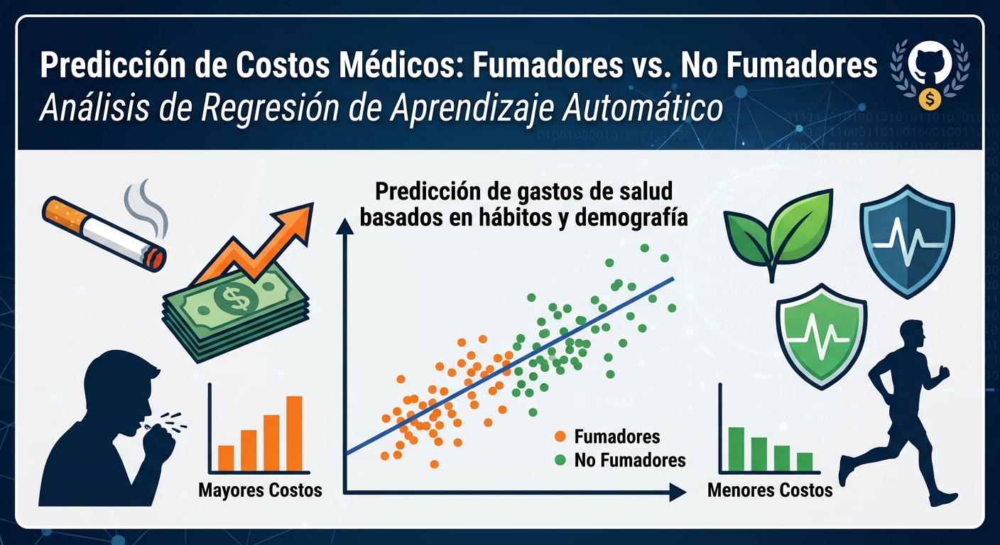

# EDA + Regresión
# 🏥 Predicción de Costos Médicos

Este proyecto estudia compara los costes sanitarios entre personas fumadores y no fumadoras.
Incluye un análisis exploratorio de datos, entrenamiento de modelos de Machine Learning y una aplicación web interactiva desarrollada con **Streamlit**.

---

## 👥 Equipo e Integrantes

* **Integrantes:**
  * Leidy Carolina
  * Miguel Anthony
  * Miguel López

---

## 🗂️ Estructura del Repositorio

```
.
├── assets/                             ← agregados al proyecto
│   └── banner_p7.jpg
│         
├── Data/                               ← Dataset files
│   └── insurance.csv
│
├── Notebooks/
│   └── edaregresion.ipynb              ← Cuaderno de Jupyter con el entrenamiento de datos
│
├── app.py                              ← Dashboard analitico e interfaz en streamlit
├── config.toml                         ← Configuración visual de streamlit
├── .gitignore
├── README.md                           ← Dodumentacion del proyecto
└── requirements.txt                    ← Dependencias y librerias necesarias
```

---

## ⚡ Características Principales
- **📊 Análisis Exploratorio de Datos (EDA):** Visualización de estadísticas descriptivas, matrices de correlación y distribuciones de costos según los hábitos de los pacientes.
- **🤖 Modelos de Machine Learning:** Entrenamiento y comparación de rendimiento ($R^2$ Score) entre:
  - Regresión Lineal
  - Regresión Polinómica (Grado 2)
  - Random Forest Regressor
- **🔮 Simulador Interactivo (Streamlit):** Una interfaz web con KPIs en tiempo real, filtros dinámicos y un formulario para estimar los costos médicos de nuevos pacientes.

---

## 🛠️ Instalación y Requisitos
1. Asegúrate de tener instalado Python 3.8 o superior.
2. Abre tu terminal, sitúate dentro de la carpeta `EDA-regression` e instala las librerías necesarias ejecutando:

   pip install -r requirements.txt

---

## 🚀 Guía de Uso

### 1. Ejecutar el Dashboard Interactivo (Streamlit)
Para abrir la aplicación web en tu navegador:

   streamlit run app.py

### 2. Ejecutar el Notebook de Jupyter
Si deseas revisar o ejecutar el código paso a paso:

   jupyter notebook edaregression.ipynb
