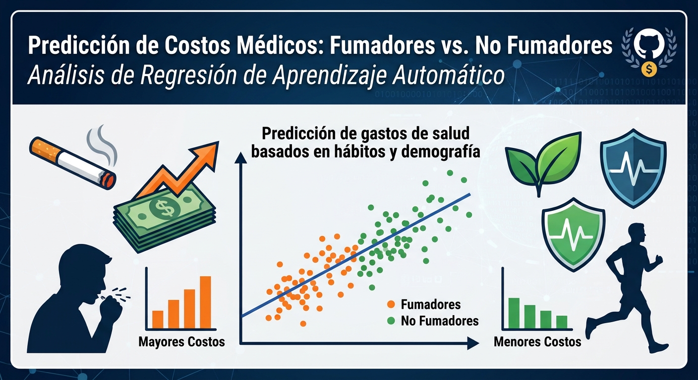

# EDA + Regresión + ML + Predicción
# 🏥 Predicción de Costos Médicos

Una aplicación web interactiva construida con **Streamlit** que utiliza un modelo de Machine Learning (**Random Forest Regressor**) para estimar los costes médicos anuales de un cliente basándose en sus características demográficas y de salud.

Incluye un análisis exploratorio de datos, en el que se compara los costes sanitarios entre personas fumadores y no fumadoras.

---

## 👥 Equipo e Integrantes

* **Integrantes:**
  * Leidy Carolina
  * Miguel López

---

## 📋 Tabla de Contenidos
1. Descripción del Proyecto
2. Estructura del Repositorio
3. Descripción del Dataset
4. Instalación y Configuración
5. Uso de la Aplicación
6. Flujo de Trabajo del Modelo
7. Mejoras Futuras

---

## 🎯 Descripción del Proyecto

El objetivo de este proyecto es proporcionar una herramienta rápida, visual e intuitiva para calcular el coste estimado de una póliza de seguro médico. El proyecto abarca todo el ciclo de vida de un modelo de Ciencia de Datos:
1. **Análisis Exploratorio y Preprocesamiento:** Limpieza de datos y codificación de variables categóricas mediante `LabelEncoder`.
2. **Entrenamiento y Serialización:** Entrenamiento de un modelo de regresión y exportación de los artefactos (`modelo_seguros.pkl` y `encoders.pkl`).
3. **Despliegue Web:** Creación de una interfaz gráfica interactiva con Streamlit para realizar inferencias en tiempo real.

---

## 🗂️ Estructura del Repositorio

```
.
├── assets/                             ← agregados al proyecto
│   └── banner_p7.jpg
│         
├── Data/                               ← Dataset files
│   └── insurance.csv
│
├── Notebooks/
│   ├── eda_regression.ipynb            ← Estudio EDA y regresión lineal del dataset
│   ├── regressions.ipynb               ← Regresión polinómica + ML + Predicción
│   └── train_model.ipynb               ← Entrenamiento del modelo ML
│
├── Pages/                              ← Ficheros Streamlit
│   ├── app.py                          
│   ├── config.toml
│   └── predi.py
│
├── Trainings/                          ← Modelos entrenados
│   ├── encoders.pkl                          
│   └── modelo_seguros.pkl
│
├── .gitignore
├── README.md                           ← Dodumentacion del proyecto
└── requirements.txt                    ← Dependencias y librerias necesarias
```

---

## 📊 Descripción del Dataset

El archivo `insurance.csv` contiene información sobre los beneficiarios de seguros médicos y los gastos facturados. Consta de las siguientes variables:

| Variable | Tipo | Descripción |
| :--- | :--- | :--- |
| `age` | Numérica | Edad del beneficiario principal (18 - 100 años). |
| `sex` | Categórica | Género del contratante (`female`, `male`). |
| `bmi` | Numérica | Índice de Masa Corporal ($kg/m^2$), indicador de peso saludable. |
| `children` | Numérica | Número de hijos cubiertos por el seguro médico / dependientes. |
| `smoker` | Categórica | Indica si el cliente es fumador (`yes`, `no`). |
| `region` | Categórica | Área residencial en EE. UU. (`northeast`, `southeast`, `southwest`, `northwest`). |
| **`charges`** | **Numérica (Target)** | **Costes médicos individuales facturados por el seguro médico ($).** |

---

## ⚙️ Instalación y Configuración

Sigue estos pasos para clonar y ejecutar el proyecto en tu entorno local:

### 1. Clonar el repositorio
```bash
git clone https://github.com/Bootcamp-DA-P3/EDA-regression.git
cd .\EDA-regression\
```

### 2. Crear y activar un entorno virtual (Opcional pero recomendado)
  ```bash
  python -m venv venv
  venv\Scripts\activate
  ```

### 3. Instalar las dependencias
Asegúrate de tener instaladas las librerías necesarias ejecutando:
```bash
pip install -r requirements.tx
```

---

## 🚀 Uso de la Aplicación

El proyecto consta de dos pasos secuenciales para su puesta en marcha:

### Paso 1: Entrenar el modelo
Antes de abrir la interfaz web, debes generar los archivos serializados del modelo y los codificadores ejecutando el script de entrenamiento:
```bash
py train.py
```
> **Nota:** Este comando leerá `insurance.csv`, entrenará el algoritmo y generará automáticamente `modelo_seguros.pkl` y `encoders.pkl` en la carpeta raíz.

### Paso 2: Iniciar la aplicación web en Streamlit
Una vez generados los archivos `.pkl`, lanza el servidor local de Streamlit:
```bash
streamlit run app.py
```
La aplicación se abrirá automáticamente en tu navegador predeterminado (normalmente en `http://localhost:8501`). Desde allí podrás ajustar los parámetros del cliente y pulsar **"Predecir Costes"** para obtener la estimación.

---

## 🧠 Flujo de Trabajo del Modelo

1. **Preprocesamiento:** Las columnas categóricas (`sex`, `smoker`, `region`) se transforman en valores numéricos mediante `LabelEncoder`. Cada codificador se almacena en un diccionario (`encoders.pkl`) para garantizar que las entradas del usuario en la web reciban exactamente la misma transformación que en la fase de entrenamiento.
2. **División de Datos:** El dataset se divide en un 80% para entrenamiento y un 20% para validación (`random_state=42`).
3. **Algoritmo:** Se utiliza `RandomForestRegressor` (100 estimadores) debido a su capacidad para capturar relaciones no lineales (como el fuerte impacto combinado entre el tabaquismo y un IMC elevado).

---

## 🔮 Mejoras Futuras

* [ ] Añadir pestaña de **Análisis Exploratorio de Datos (EDA)** con gráficos interactivos en Streamlit (Plotly/Seaborn).
* [ ] Mostrar métricas de evaluación del modelo ($R^2$, MAE, RMSE) directamente en la barra lateral de la aplicación.
* [ ] Permitir la carga masiva de clientes mediante archivos `.csv` para realizar predicciones por lotes.
* [ ] Desplegar la aplicación de forma gratuita en **Streamlit Community Cloud**.

---

⭐️ *Si este proyecto te ha resultado útil, no dudes en darle una estrella en GitHub.*